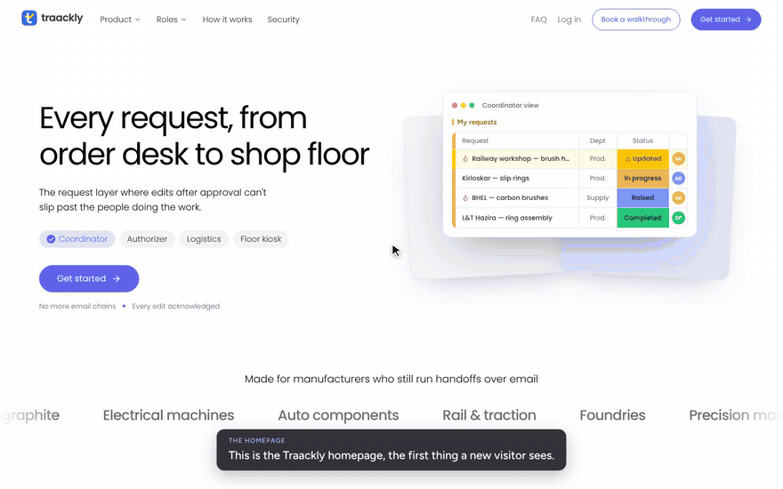
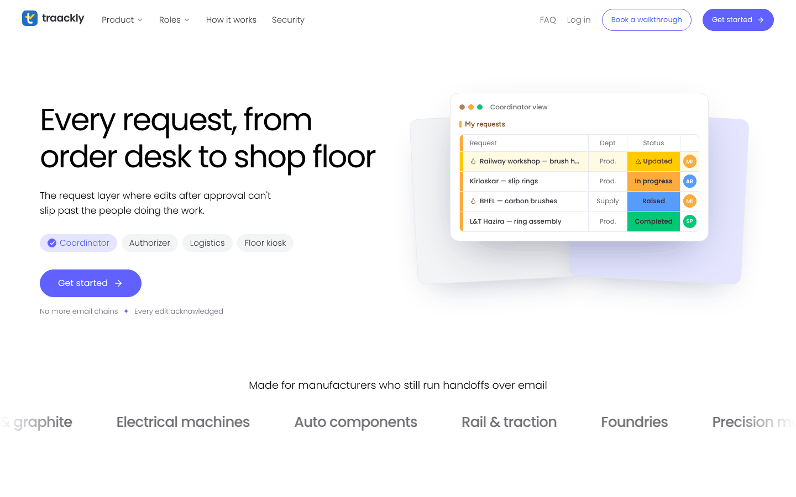
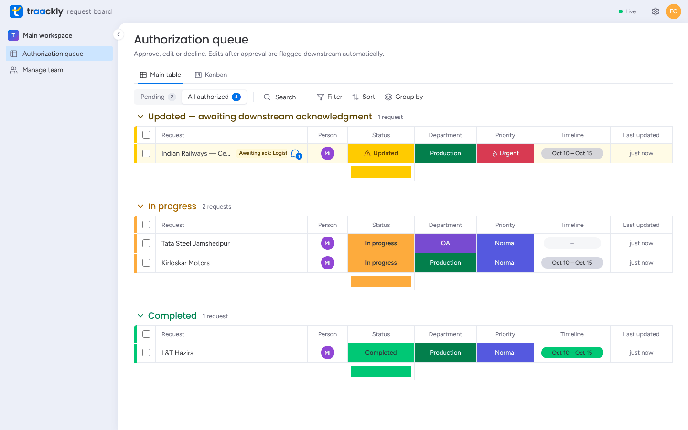
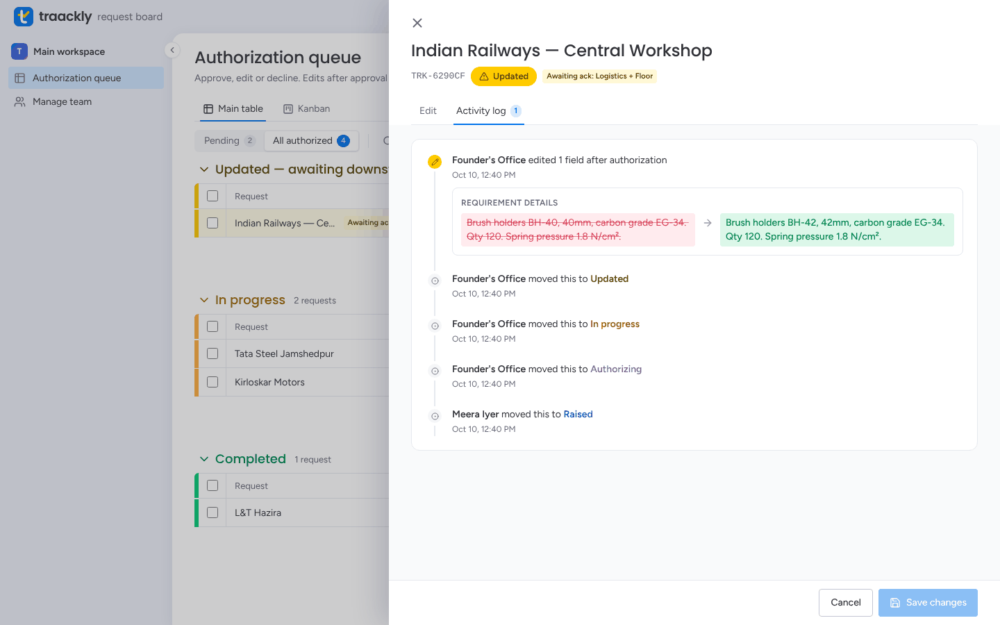
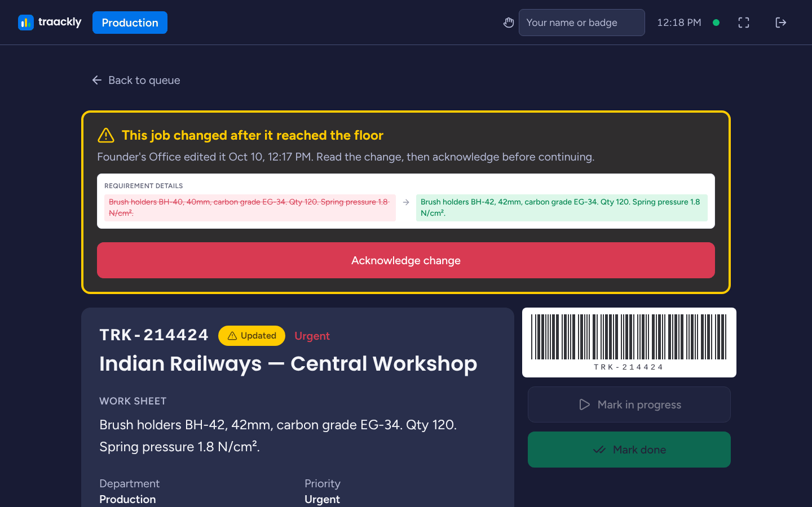

<picture>
  <source media="(prefers-color-scheme: dark)" srcset="docs/brand/traackly-logo-on-dark.svg">
  
</picture>

**Every request, from order desk to shop floor.**

At a manufacturer I worked for, an order was built to the wrong spec for weeks because a change made after approval never reached the floor. 
Traackly is the fix I designed and shipped.

[▶ Watch the walkthrough (5:54)](WALKTHROUGH.md) · [Read the case study (PDF)](docs/case-study.pdf) · [Read the PRD](docs/product-marketing/PRD.md)

A 30-second preview. Click it for the full walkthrough with voice-over.

## The problem I saw

For a year I worked in client operations at a mid-size manufacturer in India. Every client order travelled the same route: from the order desk, to the founder's office for approval, to supply and logistics, and finally to the production floor. All of it ran on email threads and phone calls.

One order, for a railway contractor, needed brush holders, slip rings and commutators. After it was approved, the spec changed. Each edit was approved somewhere in the email chain. The final version never reached Production. The floor built to the outdated spec for weeks before anyone noticed, and the order had to be reworked and delivered late.

Nobody had done anything wrong. Every person approved their slice of the thread correctly. **The failure was structural:** nothing forced the latest version of a request to travel with it.

When I asked the production team about it, they said it happens. It had become "how things work here", so nobody escalated it. A failure that everyone quietly absorbs never builds the pressure needed to fix it.

## The one rule

> **Every edit made after approval must be acknowledged by whoever works on it next, before that work can continue.**

Why this rule, and not the obvious alternatives:

- **"Just notify everyone."** Notifications are what failed. The emails were sent; nobody had to act on them.
- **"Make every change go back for approval."** That rebuilds the approval bottleneck and slows down every change.
- **Acknowledgment** is the narrowest fix. Approvals stay fast, but no one downstream can work on a version they haven't seen. The server enforces it, so it can't be skipped by clicking around the screen.

## How it works

1. **Raise.** A Coordinator raises a structured request: the client, the exact requirement, the department and the priority. It lands on one live board instead of in an inbox.
2. **Approve.** The Authorizer approves it, corrects it, or declines it with a reason.
3. **Schedule.** Logistics sets an estimated completion date, and the job appears on that department's floor kiosk.
4. **Build.** The floor works from one shared kiosk screen per department, with big type, big buttons and a barcode on every job. Floor staff don't need logins.
5. **Change, then acknowledge.** If the request is edited after approval, it turns **Updated**. Logistics and the floor are notified, *Mark done* stays locked until both have acknowledged, and every changed field is logged permanently with its old and new value.

| | |
|---|---|
|  **The homepage.** What a new visitor sees first. |  **One live board per role.** Requests grouped by stage; updates arrive in about a second, without refreshing. |
|  **Nothing changes silently.** Every edit after approval is logged field by field, and the log can't be rewritten. |  **The floor kiosk.** A changed job is flagged, and *Mark done* stays locked until someone acknowledges it. |

## Who it's for

- **The Coordinator** at a manufacturing company: the person who raises client requests and routes them across departments. Their job to be done: *"Get this request to the right team, correctly, and not have to chase it later."*
- **The floor supervisor.** Most floor staff never sit at a computer. Each department gets a shared kiosk screen instead of a login per person. That's a structural product decision, not a skin on a desktop tool.

Tools like monday.com, Asana, Trello and Freshservice are priced, designed and onboarded for desk-based teams, with one person, one login and one screen. In a floor-heavy factory, most of the people who need to see a change would never log in. The [competitive teardown](docs/product-marketing/competitive-teardown.md) compares them in detail.

## How I'd measure it

Both metrics come from two timestamps the product already records: when an edit is made, and when it's acknowledged.

- **Primary:** the share of edits made after approval that are acknowledged before work continues. The railway order is a real-world 0%; the target is as close to 100% as possible.
- **Secondary:** time to acknowledge, from the edit to the acknowledgment. It only means something under real production load, not on a quiet day.

## What I know, and what I'm still assuming

My PRD tags every claim, so first-hand evidence never gets mixed up with guesses.

| Confirmed first-hand | Still to validate |
|---|---|
| The railway order was built to an outdated spec for weeks, causing rework and a late delivery. | How often this happens, and what each incident costs in rework hours or days of delay. |
| The production team described it as a known, recurring problem. | Market size, and the claims about how fast this segment is digitising. |
| Kiosk screens are stationed per department, not per person. | Whether floor supervisors find the kiosk easy to use in practice. |
| | Which market to launch in first: India, or broader. |

## My role

I found the problem first-hand and wrote the [PRD](docs/product-marketing/PRD.md): the problem framing, personas, success metrics, user stories and scope. I defined the one rule, and I directed the product, design and brand choices: the board-style interface, the floor kiosk, the "t-check" logo, the homepage and the walkthrough video.

I built the working software with an AI coding assistant (Claude Code), directing it from my PRD rather than writing the code by hand. That is how one product marketer can take an idea from a real problem to a shipped, tested product without an engineering team. The full engineering trail is in this repo for anyone who wants to check it.

## The marketing work

| Document | What it shows |
|---|---|
| [Product requirements (PRD)](docs/product-marketing/PRD.md) | Problem discovery, personas, metrics, user stories and scope, written before the build |
| [Positioning & messaging](docs/product-marketing/positioning.md) | Positioning statement, message house and proof points |
| [Competitive teardown](docs/product-marketing/competitive-teardown.md) | monday.com, Asana, Trello and Freshservice against this segment's needs, with sources |
| [Go-to-market plan](docs/product-marketing/gtm-plan.md) | Ideal customer, channels, pricing hypothesis, launch steps and metrics |
| [Walkthrough](WALKTHROUGH.md) | The 5:54 product video with chapters, plus short cuts for social |
| [Case study (PDF)](docs/case-study.pdf) | The one-page version of this story |
| [Brand kit](docs/brand) | Logo, colours and usage rules |

## What I'd do next

1. **Validate before building more.** Run the interviews the PRD calls for, to measure how often post-approval changes go missing and what each one costs.
2. **Pilot with one manufacturer, on one product line.** Compare the share of acknowledged changes against today's email-based baseline.
3. **Test the kiosk with real floor supervisors** before adding any kiosk features.
4. **Write up the pilot as a case study.** Real numbers from a real shop floor are the next marketing asset.

Multi-language support, a client-facing status portal and analytics stay deferred until the core rule is proven, exactly as the PRD's roadmap says.

---

### For engineers

Go API, React client, MongoDB, live updates over WebSockets, and a shared-screen kiosk mode. The acknowledgment rule is enforced on the server, below the HTTP layer, and the change log is append-only at the database level.

- `TestRailwayOrderIncidentEndToEnd` replays the incident above through the real API: raise, approve, schedule, edit, flag, block, acknowledge, unblock.
- `TestChangelogIsAppendOnly` proves that a forged rewrite of history is not stored.

Architecture, setup, quality gates and deployment are in **[TECHNICAL.md](TECHNICAL.md)**.
