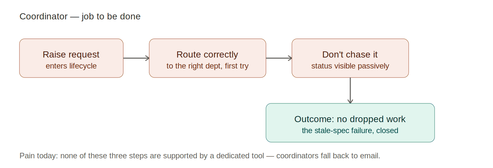
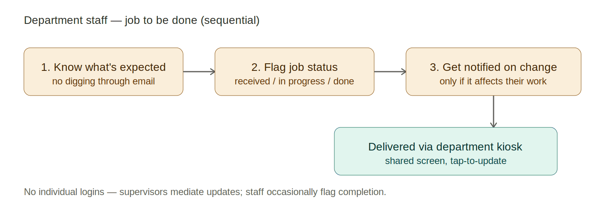
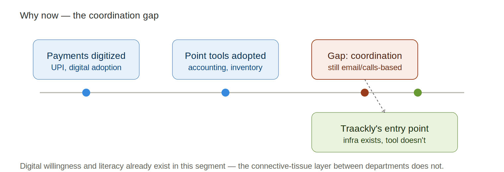
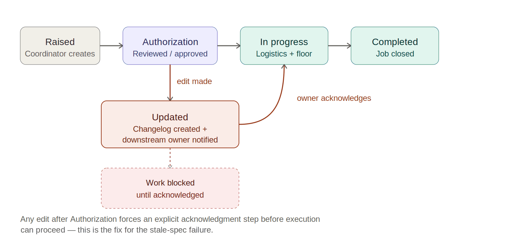
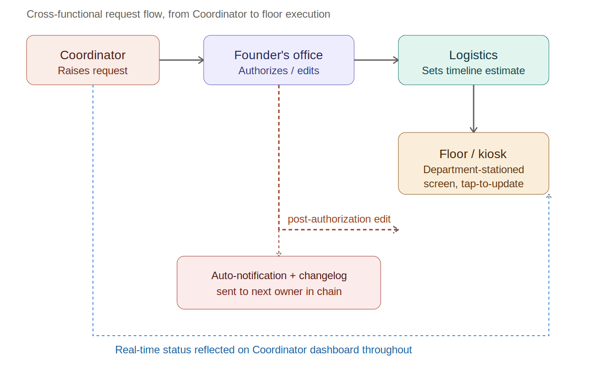
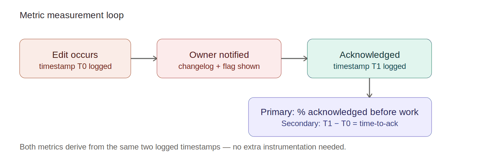
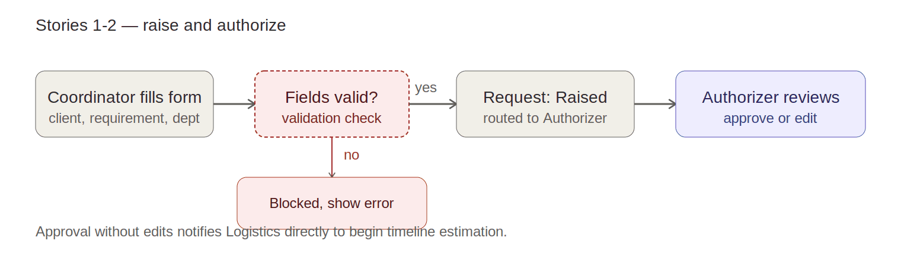
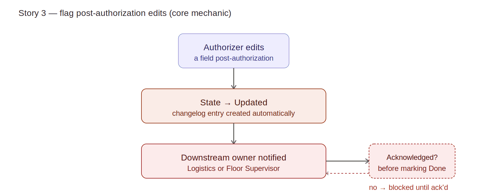
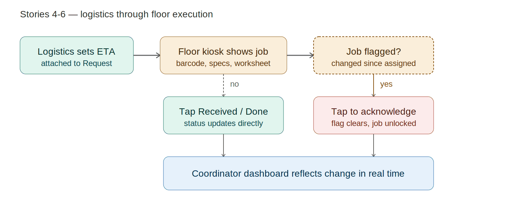
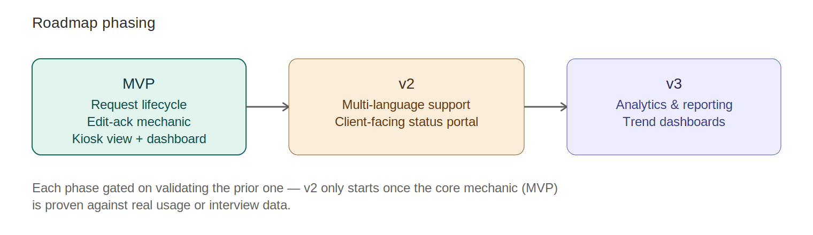

# Traackly — Product Requirements Document

*A lightweight cross-departmental request-tracking layer for SMBs*

> **About this document.** This is the original PRD, written in August 2026 before the build began. It is kept as written, apart from anonymising the company where the problem was observed. Each claim is tagged **CONFIRMED**, **ASSUMPTION** or **OPEN QUESTION**, so first-hand evidence stays separate from what still needs validation. The shipped product follows it closely; the few places where the build differs are listed in [TECHNICAL.md](../../TECHNICAL.md#where-this-build-differs-from-the-spec-docs-and-why).

|             |                                                                                     |
|-------------|-------------------------------------------------------------------------------------|
| **Author**  | Product Marketing Candidate — MiM                                                   |
| **Status**  | Draft v1.1 — expanded with process visualizations                                   |
| **Date**    | August 2026                                                                         |
| **Origin**  | First-hand experience — Client Operations Associate at a mid-size manufacturer in India         |
| **Purpose** | Portfolio PRD demonstrating problem framing, discovery, and requirements definition |

## 1. Executive summary

> *We're building Traackly, a lightweight request-tracking layer for
> cross-functional coordinators at SMBs, to solve the problem of
> requests having no structured home — living instead in scattered
> emails and calls — which cascades into lost visibility, unclear
> ownership, and dropped work. This will reduce dropped and forgotten
> requests to near-zero, restoring the foundation that lets speed and
> accountability follow naturally.*

Traackly is not positioned as a full project-management suite. It is a
focused request and handoff visibility layer designed specifically for
manufacturing SMBs, where cross-department coordination still happens
informally — over email threads and phone calls — because the existing
generation of PM tools (Monday, Asana, Trello, Freshservice) are priced,
designed, and onboarded for desk-based knowledge work, not floor-heavy
manufacturing operations.

The product's single organizing idea is narrow by design: every request
that changes after it has been authorized must be explicitly
acknowledged by whoever executes it next, before that execution can
proceed. This one mechanic is the direct, evidence-backed fix for a
specific and recurring failure mode witnessed first-hand — not a
general-purpose claim about "better project management." Everything else
in this document — the personas, the lifecycle, the metrics, the roadmap
— exists in service of proving that one mechanic works, first in a
portfolio prototype and later, potentially, in a real SMB deployment.

This document is written as a living artifact for a Master's in
Management (MiM) product marketing portfolio project. It intentionally
separates what has been witnessed first-hand (and can be defended in an
interview) from what is assumed or requires further validation — each is
tagged accordingly throughout.

## 2. Problem statement

### Who has this problem?

Cross-functional coordinators at mid-size manufacturing SMBs — and the
departments they route work through — who manage client requests
spanning multiple teams: sales and client onboarding, internal
authorization (typically the founder's office in a company this size),
supply and logistics, and production/floor execution. This is not a
hypothetical persona; it describes the role the author held for a full
year at a mid-size manufacturing company in India.

### What is the problem?

Requests and their updates travel through email chains across
departments with no single source of truth. When a request changes
mid-flight — even a "minor" spec update — each stakeholder in the chain
sees and approves only their slice of the thread. The cumulative,
current state of the request is never visible to the team that
ultimately executes it. Critically, this is not a failure of any
individual's diligence: every person in the chain did their job
correctly by their own local view of the email thread. The failure is
structural — there is no mechanism that forces the full, current state
of a request to travel with it.

### Why is it painful?

- Business impact: Production works off stale specs, causing rework,
  scrap, and delivery delays.

- Recurring, not isolated: when casually raised with the
  Supply/Production team, their response indicated this was a known,
  recurring bottleneck — not a surprising one-off.

- Normalized internally: the most concerning signal isn't the failure
  itself, but that internal teams had stopped treating it as
  escalation-worthy — it had become accepted friction rather than a
  flagged risk. A failure mode that is silently absorbed as "how things
  work here" is more dangerous than one that gets escalated, because it
  never generates the internal pressure needed to fix it.

### Evidence

- First-hand incident: a railway contractor order (brush holders,
  slip rings, commutators) was onboarded, sent for authorization, and
  routed to Production. Mid-process spec edits were each individually
  approved through the email chain, but the final updated requirement
  never reached Production — who built to outdated specs for weeks
  before the gap surfaced, causing rework and delivery delay.

- Internal signal: when informally asked about this bottleneck, the
  Supply/Production team's response suggested this was a familiar,
  recurring issue rather than an isolated incident — not a client
  complaint, but an internal admission of a known gap.

**OPEN QUESTION** Validate prevalence/frequency via planned interviews
with the company's founder's office and former colleagues — how often does
this occur, and what's the estimated cost per incident, in rework hours
or delivery delay days?

## 3. Target users & personas

The product deliberately serves two personas with very different needs
and interaction models, connected by the same underlying request.
Designing for both from day one — rather than treating one as an
afterthought — is what makes the kiosk-based execution model (see below)
a genuine differentiator rather than a bolt-on.

### Primary persona — The Coordinator

- Role: cross-functional coordinator (client ops, order/request
  originator).

- Tech comfort: tech-fluent — already comfortable with supply/logistics
  software. The gap isn't skill; it's the absence of a dedicated tool
  for cross-department request tracking specifically.

- Job-to-be-done: "Get this request to the right team, correctly, and
  not have to chase it later."

- Pain today: requests get edited mid-flight across email chains; no way
  to confirm the final state actually reached execution.

*Figure 1 — Coordinator's job-to-be-done, expressed as a three-step flow
ending in the outcome that closes the stale-spec failure mode.*

### Secondary persona — Department staff (Production / Supply / QA)

- Role: floor-based staff and supervisors receiving and executing
  requests.

- Tech comfort: kiosk / shared-screen access model — supervisors update
  status at fixed entry-point screens; staff occasionally flag job
  completion. No individual logins, no fixed personal workflow.

- Jobs-to-be-done are sequential, not simultaneous — each step only
  matters once the previous one is satisfied.

*Figure 2 — Department staff's three sequential jobs-to-be-done, all
delivered through a single shared kiosk touchpoint.*

**CONFIRMED** Kiosk screens are stationed per department (not per
individual, not shared across multiple departments on one screen) — each
department has its own dedicated kiosk view showing only jobs relevant
to that station.

This kiosk detail matters more than it might first appear. Most PM tools
implicitly assume one person, one login, one desktop view. That
assumption breaks completely for a floor/warehouse-heavy SMB workforce,
where the majority of staff never sit at an individual computer.
Designing the execution-side interface around a shared, department-level
touchpoint from the outset — rather than retrofitting a desktop tool
with a "kiosk mode" later — is a structural product decision, not a UI
skin.

## 4. Strategic context

### Business goals

This is a portfolio and academic initiative (MiM project) aimed at
demonstrating end-to-end product marketing capability — problem
discovery, positioning, PRD development, and a working prototype
teardown against incumbents. It is not tied to a company's OKRs, and no
revenue or funding claims are implied at this stage.

### Market opportunity

**OPEN QUESTION** TAM/SAM/SOM sizing deferred — requires market research
on manufacturing SMB counts and current tooling adoption rates. To be
validated in a later phase, once the core mechanic has been demoed.

### Competitive landscape

Existing PM and workflow tools (Monday, Asana, Trello, Freshservice) are
largely priced, designed, and onboarded for knowledge-work and
desk-based teams. Enterprise pricing tiers, feature complexity, and
desktop-first UX assumptions create friction for manufacturing SMBs —
particularly ones with a floor/warehouse-heavy workforce structure,
where the majority of the intended "team" would never actually log into
the tool. A full comparative teardown, mapping each incumbent's pricing
tier, onboarding flow, and mobile/kiosk support against this specific
segment's needs, is deferred until a working prototype exists — this is
intentional, so the teardown can be grounded in a real point of
comparison rather than a theoretical one.

### Why now

SMB digitization in manufacturing and adjacent sectors has accelerated
in recent years — point solutions for payments, accounting, and
inventory have seen strong, largely uncontested adoption. However,
workflow and coordination tooling between departments has visibly lagged
behind. SMBs in this segment have adopted some digital infrastructure,
but the "connective tissue" layer — the thing that tracks a request as
it moves across departments — remains largely unaddressed by affordable,
non-enterprise tools.

*Figure 3 — The coordination gap: digital adoption has moved through
payments and point tools, but cross-departmental coordination has been
left behind.*

This creates a timing gap rather than a technology gap: the willingness
and baseline digital literacy already exist in this segment (staff are
already comfortable with supply/logistics software, as noted in the
Coordinator persona), but no lightweight solution has specifically
targeted the coordination layer between departments. This market-level
gap is reinforced by first-hand experience: a recurring,
internally-normalized failure mode observed first-hand suggests this isn't
a hypothetical gap but a lived, recurring one.

**OPEN QUESTION** Validate the market-shift claims (digitization stats,
point-solution adoption rates) with actual sources before using this in
an external-facing pitch or fundraising context.

## 5. Solution overview

Traackly is a lightweight, cross-departmental request-tracking layer.
Coordinators raise structured Requests that move through a defined
lifecycle, replacing scattered email and call-based routing with a
single source of truth. Any request edited after Authorization
automatically notifies the next execution-stage owner with a visible
changelog — closing the exact gap that caused the railway-order incident
described in the Problem Statement.

*Figure 4 — Request lifecycle. Post-authorization edits force an
acknowledgment step before execution can proceed.*

### Core object: Request

- Lifecycle states: Raised → Authorization → In progress → Updated (if
  changed) → Completed.

- Edit behavior: any post-Authorization edit triggers an automatic
  notification and visible changelog to the next execution-stage owner.
  This is an acknowledgment, not a re-approval — it doesn't recreate the
  original authorization bottleneck, but it ensures no one downstream
  can plausibly claim ignorance of a change, which is exactly what
  happened in the railway-order incident.

*Figure 5 — Cross-functional request flow, from Coordinator to floor
execution, including the edit-notification branch.*

### Key user flows

- Coordinator flow: raise request → route for authorization → track
  status → get notified on major state changes or blockers.

- Authorization flow: founder's office / authorizer reviews, approves,
  or edits the request — any edit is logged and flagged downstream
  automatically, with no extra manual step required from the authorizer.

- Execution flow (floor/kiosk): supervisor views assigned jobs on a
  shared, department-stationed kiosk screen — each job card shows
  barcode/product ID, custom specs, and a detailed work sheet, mirroring
  what was actually observed on the factory floor. Supervisor taps to
  update status or acknowledges an incoming change-flag before
  proceeding.

### Key features (MVP-level)

- Request creation and routing (Coordinator).

- Authorization/approval step with automatic edit-logging.

- Automatic downstream notification and changelog on edits — the core
  mechanic.

- Kiosk-mode execution view: job cards with barcode/spec sheet,
  tap-to-update status, change acknowledgment.

- Status dashboard (Coordinator-facing) — real-time visibility across
  all active requests, without manual chasing.

## 6. Success metrics

Both metrics below are deliberately derived from the same two logged
timestamps — the moment an edit is made, and the moment it's
acknowledged. This keeps the instrumentation minimal and means both the
primary and secondary metric can be demonstrated directly in a clickable
prototype, without needing a live production deployment to generate the
data.

*Figure 6 — Both metrics are derived from two timestamps logged
automatically by the core edit-acknowledgment mechanic.*

### Primary metric

Percentage of requests where a post-Authorization edit is acknowledged
by the downstream execution owner before work proceeds.

- Target: as close to 100% as possible — the railway-order incident represents a
  real-world 0% case (edit never acknowledged, work proceeded on stale
  spec).

- Why this is primary: this is the exact, specific failure mode
  witnessed first-hand; it's falsifiable and demoable in a prototype,
  and doesn't require inventing a metric the author can't personally
  speak to.

### Secondary metric

Time-to-acknowledge — the elapsed time between an edit being made and
the downstream owner acknowledging it.

**ASSUMPTION** In the railway-order case, acknowledgment (when it eventually
happened) wasn't slow because the floor was occupied with prior jobs —
meaning low urgency masked the real risk rather than the system
performing well. This metric is only meaningful when measured under
active production load, not during idle periods, and should be
stress-tested accordingly once real usage data exists.

**OPEN QUESTION** Broader metrics (manual escalation frequency, overall
resolution speed) are plausible downstream benefits but not validated
first-hand — defer claims here until real usage data or structured
interviews exist.

## 7. User stories & requirements

**Epic hypothesis:** *If we give Coordinators a structured Request
lifecycle with mandatory downstream acknowledgment on post-Authorization
edits, then dropped or stale-spec incidents (like the railway
order) will be eliminated, because execution owners can no longer be
unaware of changes.*

The seven stories below are grouped into three flows for the
accompanying diagrams: raising and authorizing a request (Stories 1-2),
the core edit-acknowledgment mechanic in isolation (Story 3, the single
most important flow in this document), and the downstream
logistics-through-floor-execution chain (Stories 4-6), with the
Coordinator dashboard (Story 7) as the constant thread that ties all of
them together in real time.

*Figure 7 — Stories 1-2: request creation with field validation, then
authorization.*

**Story 1 — Raise a request**

*As a Coordinator, I want to raise a Request with details (client,
requirement, department routing) so that it enters a trackable lifecycle
instead of an email thread.*

> **Given** I am a Coordinator, **when** I create a new Request with
> client info, requirement details, and target department, **then** the
> Request is created in "Raised" state and routed to the Authorizer.
>
> **Given** a Request is missing required fields, **when** I try to
> submit it, **then** I am blocked with a clear error indicating what's
> missing.

**Story 2 — Authorize a request**

*As an Authorizer, I want to review and approve/edit a Request so that
downstream teams work from an authorized version.*

> **Given** a Request is in "Raised" state, **when** the Authorizer
> reviews it, **then** they can approve (moving it to "Authorization" →
> "In progress") or edit it before approving.
>
> **Given** an Authorizer approves without edits, **when** the Request
> moves to "In progress", **then** Logistics is notified to begin
> timeline estimation.

*Figure 8 — Story 3, the core mechanic: any post-authorization edit
forces an explicit acknowledgment gate before execution can proceed.*

**Story 3 — Flag post-authorization edits (core mechanic)**

*As an Authorizer, when I edit a Request post-authorization, I want the
system to automatically flag the change to the next execution owner so
that no edit goes unseen.*

> **Given** a Request is already Authorized/In progress, **when** the
> Authorizer edits any field, **then** the Request moves to "Updated"
> state and a changelog entry is created showing what changed and when.
>
> **Given** a Request enters "Updated" state, **when** the change is
> saved, **then** the next execution-stage owner (Logistics or Floor
> Supervisor) receives an automatic notification.
>
> **Given** a downstream owner has not yet acknowledged an "Updated"
> Request, **when** they attempt to mark related work as "In progress"
> or "Done", **then** they are blocked/prompted to acknowledge the
> change first.

*Figure 9 — Stories 4-6: Logistics timeline estimation, kiosk display,
and the acknowledgment gate, all converging on the Coordinator's
real-time dashboard.*

**Story 4 — Logistics timeline estimation**

*As a Logistics/Planning team member, I want to see newly authorized
Requests and set an estimated execution timeline so that Production has
a clear schedule, and this estimate updates automatically if the Request
changes post-authorization.*

> **Given** a Request is newly Authorized, **when** Logistics reviews
> it, **then** they can set an estimated execution timeline attached to
> the Request.
>
> **Given** a Request with an existing timeline enters "Updated" state,
> **when** Logistics is notified of the change, **then** they are
> prompted to review/revise the timeline before it's passed to the Floor
> Supervisor.

**Story 5 — Kiosk view for floor execution**

*As a Floor Supervisor, I want to see my department's active jobs on a
kiosk screen (with barcode, specs, work sheet) so that I know exactly
what to execute.*

> **Given** a Request has been routed to my department, **when** I view
> the department kiosk screen, **then** I see a job card with
> barcode/product ID, custom specs, and a detailed work sheet.
>
> **Given** the kiosk screen is department-stationed (not
> per-individual), **when** any supervisor at that station views it,
> **then** they see the same shared job queue for that department.

**Story 6 — Acknowledge flagged changes**

*As a Floor Supervisor, I want to acknowledge a flagged change on a job
before proceeding so that I never work off a stale spec.*

> **Given** a job's Request is in "Updated" state, **when** I view it on
> the kiosk, **then** it's visually flagged (highlighted/badge) as
> changed, showing what's different from before.
>
> **Given** a flagged job, **when** I tap to acknowledge the change,
> **then** the flag clears and the job becomes actionable (status can
> move to In progress/Done).
>
> **Given** I have not acknowledged a flagged change, **when** I try to
> mark the job "Done", **then** I am blocked until acknowledgment
> occurs.

**Story 7 — Coordinator status dashboard**

*As a Coordinator, I want a real-time status dashboard of all my raised
Requests so that I don't have to manually chase updates.*

> **Given** I am a Coordinator, **when** I open my dashboard, **then** I
> see all Requests I've raised with their current state
> (Raised/Authorization/In progress/Updated/Completed).
>
> **Given** a Request I raised changes state, **when** the change
> occurs, **then** my dashboard reflects it without manual
> refresh/chasing.

## 8. Out of scope

Scope discipline matters more in a solo/portfolio build than in a funded
team, because there is no second person to catch drift. The MVP is
intentionally narrow: it exists to prove the single core mechanic (Story
3) works end-to-end, not to be a feature-complete product.

*Figure 10 — Roadmap phasing. Each later phase is gated on validating
the one before it, starting with the MVP's core mechanic.*

### Not included in MVP

- Multi-language support — mentioned early in ideation as a
  differentiator, but not core to validating the edit-acknowledgment
  mechanic. Deferred to v2.

- Client-facing status portal/notifications — external-facing visibility
  is a real future value-add, but MVP focuses on internal
  cross-department flow first.

- Advanced analytics/reporting/trend dashboards — the Coordinator
  dashboard (Story 7) is a real-time status view, not analytics. Trend
  reporting, historical analysis, and BI-style dashboards are explicitly
  deferred.

### Future consideration

- Multi-language, client portal, and analytics all remain plausible
  v2/v3 candidates once the core mechanic is validated against real
  usage or interview data.

## 9. Dependencies & risks

### Dependencies

- Prototype build: no-code / AI-assisted clickable prototype — to be
  built solo, no external engineering dependency.

- Validation data: planned interviews with the company's founder's office and
  former colleagues to validate frequency/prevalence of the edit-drop
  failure mode.

- Competitive teardown: deferred until prototype exists, so it can be
  grounded against a real point of comparison.

### Risks & mitigations

**OPEN QUESTION** Specific execution risks (scope creep, time
constraints, prototype credibility) not yet identified with confidence —
to be revisited iteratively as the build progresses rather than
pre-guessed now. This is a deliberate choice to avoid inventing false
certainty in a section where the honest answer is "not yet known."

## 10. Open questions

- Validate prevalence/frequency of the edit-drop failure mode via validation
  interviews.

- Validate market-shift/digitization claims with real sources before
  external use.

- Validate kiosk usability assumptions once prototype exists.

- Determine GTM geography (India-first vs. broader) — deferred from
  strategic context.

- Identify project-specific risks once build is underway.

## Self-assessment

- Strongest section: Problem Statement — grounded in a specific,
  verifiable first-hand incident with a clear causal chain from
  unstructured workflow to lost visibility to dropped work.

- Weakest section: Strategic Context / market sizing — lacks external
  data, currently assumption-driven and explicitly flagged as such.

- Top assumption to validate first: frequency and cost of the edit-drop
  failure mode, via the planned validation interviews.

- Recommended next step: conduct the validation interviews, then
  begin the clickable prototype build, prioritizing Story 3 (the core
  mechanic) first since every other story depends on it being
  demonstrable.
